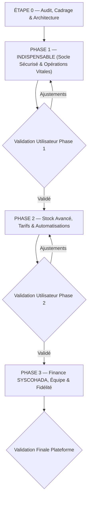

# PLAN DE REFONTE & D'EXTENSION ERP — YOS360

**Projet** : YOS360 — ERP SaaS Multi-Tenant & Multi-Sites UEMOA  
**Norme de livraison** : Phase par phase avec validation intermédiaire obligatoire  
**Date d'établissement** : 19 Octobre 2026  
**Document de référence** : [docs/AUDIT.md](file:///c:/Users/OUANGRAWA/Desktop/P%20Digital/YOS360/docs/AUDIT.md)

---

## 1. Vue d'Ensemble des Phases de Développement

---

## 2. Découpage Détaillé par Phase

---

### ÉTAPE 0 — AUDIT & ARCHITECTURE PRÉALABLE (EN COURS)
- [x] **0.1 Analyse approfondie du dépôt** : stack, arborescence, schémas de BDD, RLS, offline, UI.
- [x] **0.2 Production de `docs/AUDIT.md`** : recensement existant, réutilisabilité, failles RLS, dettes techniques et écarts.
- [x] **0.3 Production de `docs/PLAN.md`** : phasage détaillé, migrations up/down, identification des risques.
- [ ] **0.4 Restructuration de base de l'architecture des espaces** :
  - **Espace Super Admin Plateforme** (séparé) avec fonction d'impersonation tracée.
  - **Espace Entreprise (Tenant)** avec le nouveau menu 8 sections ordonné.
  - Sélecteur de site global dans l'en-tête (`site_id`).
  - Nettoyage des badges statiques (SCAN, AUTO, VENTE, etc.) au profit de compteurs dynamiques réels.

---

### PHASE 1 — INDISPENSABLE (LIVRER EN PREMIER)

#### 1.1 Rôles & Permissions (RBAC Granulaire BDD)
- **Objectif** : Remplacer la matrice TypeScript statique par un système de permissions dynamique en base de données avec contrôle d'accès par site et par action.
- **Tâches** :
  1. *Migration SQL* :
     - Créer les tables `roles`, `permissions`, `role_permissions`, `user_roles`, `user_sites`.
     - Insérer les 6 rôles par défaut : `Propriétaire`, `Gérant`, `Comptable`, `Magasinier`, `Caissier`, `Vendeur`.
     - Insérer les permissions granulaires sous format `module.action` (ex. `achats.bon_commande.creer`, `achats.bon_commande.valider`, `ventes.facture.creer`, `caisse.session.ouvrir`, `caisse.session.cloturer`).
     - Corriger la faille RLS `is_admin()` : aucun administrateur de tenant ne peut voir les données d'un autre tenant.
  2. *API & Logique Métier* :
     - Helpers de permission côté client : `hasPermission(user, 'achats.bon_commande.valider', siteId)`.
     - Garde-fous côté Supabase (fonctions Security Definer).
  3. *Interface Utilisateur* :
     - Écran de matrice de permissions (Modules × Actions) dans `Administration > Utilisateurs & Rôles`.
     - Écran d'assignation des sites par utilisateur.
     - Prise en charge 2FA (TOTP) et liste des sessions actives avec révocation en un clic.

#### 1.2 Module Achats Complet
- **Objectif** : Structurer l'ensemble de la chaîne d'approvisionnement des PME.
- **Tâches** :
  1. *Migration SQL* :
     - Créer les tables : `achats_demandes`, `achats_demande_lignes`, `achats_bons_commande`, `achats_bc_lignes`, `achats_receptions`, `achats_reception_lignes`, `achats_factures`, `achats_retours`.
     - Intégrer les clés `tenant_id`, `site_id`, `created_by`, `deleted_at`.
     - Trigger de calcul automatique du CMUP lors d'une réception validée.
  2. *Logique Métier* :
     - Workflow formel : Demande d'achat → Bon de commande fournisseur → Réception (partielle ou totale, par site) → Facture fournisseur → Retour fournisseur.
     - Rapprochement 3 voies (BC / Réception / Facture) avec signalement des écarts de quantité et de prix.
     - Intégration avec le module Réappro : génération automatique de brouillons de bons de commande groupés par fournisseur.
  3. *Interface Utilisateur* :
     - Vues listes et fiches détaillées pour chaque étape du cycle Achats.
     - Bouton de conversion 1-clic d'une étape à la suivante avec reliquats automatiques.

#### 1.3 Ventes & Facturation Structurée
- **Objectif** : Séparer rigoureusement les ventes des achats, gérer la chaîne documentaire complète avec PDF officiel conforme UEMOA.
- **Tâches** :
  1. *Migration SQL* :
     - Créer les tables : `ventes_devis`, `ventes_commandes`, `ventes_livraisons`, `ventes_factures`, `ventes_avoirs`, ainsi que leurs tables de lignes respectives.
     - Numérotation séquentielle stricte sans trou par tenant et par an (ex: `DEV-2026-00001`, `CMD-2026-00001`, `BL-2026-00001`, `FAC-2026-00001`, `AVO-2026-00001`).
     - Machine à états : `brouillon` → `valide` → `partiellement_livre` → `cloture` / `annule`.
     - Règle d'inviolabilité : une facture validée est verrouillée ; seule une annulation par avoir est autorisée.
  2. *Génération de Documents PDF* :
     - Modèle de document commercial aux normes UEMOA/Burkina Faso : Numéro IFU, RCCM, Division fiscale, logo, TVA 18%, mentions de garantie, QR code de validation.
  3. *Retours Clients* :
     - Module de retours clients avec réintégration sélective au stock et émission d'avoir.

#### 1.4 Caisse Enregistreuse (POS) Professionnelle
- **Objectif** : Offrir un point de vente tactile, rapide, sécurisé, multi-moyens de paiement et résistant aux coupures internet.
- **Tâches** :
  1. *Migration SQL & Sessions de Caisse* :
     - Créer les tables : `caisse_postes`, `caisse_sessions`, `caisse_mouvements_fond`, `caisse_ventes`, `caisse_ventes_lignes`, `caisse_paiements`.
     - Cycle d'une session : Ouverture avec fond de caisse obligatoire → Enregistrement des ventes → Clôture avec comptage physique des espèces et des coupons Mobile Money → Calcul de l'écart → Génération et impression du Ticket Z.
  2. *Paiements Multiples & Fractionnés* :
     - Possibilité de régler un même panier par plusieurs moyens (ex: 5 000 FCFA Espèces + 15 000 FCFA Orange Money + solde à crédit).
  3. *Impression Tickets* :
     - Format thermique 58 mm et 80 mm avec en-tête ticket, détail articles, taxes, rendu monnaie, code de retrait/vérification.
  4. *Mode Hors-ligne Robuste* :
     - Stockage complet du catalogue et des paniers dans IndexedDB.
     - File de synchronisation locale avec détection automatique du réseau.
     - Résolution de conflits de stock côté serveur via procédure stockée atomique.

#### 1.5 Paiements, Mobile Money & Gestion des Créances
- **Objectif** : Suivi rigoureux de la trésorerie et intégration des moyens de paiement phares d'Afrique de l'Ouest.
- **Tâches** :
  1. *Migration SQL* :
     - Table unifiée `payments` rattachée aux factures clients ET factures fournisseurs.
     - Prise en charge des paiements partiels et du règlement d'un lot de factures en un seul versement.
  2. *Mobile Money (Adapter Pattern)* :
     - Architecture modulaire d'adaptateurs pour : Orange Money Burkina, Moov Money (Flooz), Wave, Virement bancaire, Chèque, Espèces.
     - Phase 1 : Saisie manuelle assistée avec contrôle du format de la référence de transaction télécom.
  3. *Balance Âgée & Plafonds de Crédit* :
     - Calcul dynamique des tranches de créances : 0-30 jours, 31-60 jours, 61-90 jours, +90 jours.
     - Plafond de crédit client bloquant au niveau du POS et de la validation des commandes.

---

### PHASE 2 — STOCK AVANCÉ, TARIFS & AUTOMATISATION

- **2.1 Traçabilité fine & FEFO** :
  - Lots, numéros de série, dates de péremption (DLUO).
  - Algorithme de déstockage automatique FEFO (First Expired, First Out).
  - Alertes visuelles et notifications automatiques à J-30 et J-7.
- **2.2 Valorisation du Stock** :
  - Méthodes configurables par tenant : CMUP (Coût Moyen Unitaire Pondéré) ou FIFO.
- **2.3 Nomenclatures, Variantes & Unités** :
  - Unités de mesure avec table de conversion (ex. 1 Carton = 10 Paquets = 100 Pièces).
  - Variantes de produits (taille, couleur, conditionnement).
  - Kits et produits composés avec décrémentation automatique des composants.
- **2.4 Ajustements de Stock Réglementés** :
  - Formulaire d'ajustement avec motif obligatoire (casse, vol, échantillon, péremption, écart inventaire).
  - Seuil de valeur déclenchant une validation par le gérant.
- **2.5 Grilles Tarifaires & Promotions** :
  - Listes de prix par catégorie de clients (Détail, Demi-gros, Grossiste).
  - Remises quantitatives, promotions datées, coupons et codes promo.
- **2.6 Workflows de Validation & Notifications** :
  - Écran « Validations en attente » pour bons de commande, remises exceptionnelles, transferts inter-sites.
  - Système de notification in-app + e-mail + passerelle SMS/WhatsApp (format adapter).
- **2.7 Webhooks Sortants & API Développeur** :
  - Émission d'événements signés par HMAC (`vente.creee`, `stock.alerte`, `facture.payee`).
  - Clés d'API avec scopes fins (`ventes:read`, `stock:write`).

---

### PHASE 3 — FINANCE SYSCOHADA, ÉQUIPE & FIDÉLITÉ

- **3.1 Pré-Comptabilité SYSCOHADA Révisé** :
  - Plan comptable général OHADA pré-configuré (Comptes classes 1 à 7).
  - Journaux auxiliaires : Ventes, Achats, Banque, Caisse, Opérations Diverses.
  - Génération automatique des écritures comptables à partir des factures et encaissements/décaissements.
  - Grand livre, balance générale et export FEC / Excel.
- **3.2 Trésorerie & Dépenses** :
  - Gestion des comptes bancaires et des comptes marchands Mobile Money.
  - Rapprochement bancaire assisté.
  - Gestion des charges et dépenses d'exploitation par catégorie budgétaire.
- **3.3 Gestion de l'Équipe & Commissions** :
  - Fiche collaborateur, rattachement aux sites d'affectation.
  - Règles de calcul des commissions vendeurs (% sur CA ou marge).
  - Suivi des objectifs mensuels par vendeur et par boutique.
- **3.4 Programme de Fidélité & Vue Client 360°** :
  - Cumul de points de fidélité, paliers de fidélité (Bronze, Argent, Or).
  - Vue Client 360° : historique d'achats, panier moyen, solde dû, retours, préférences.

---

## 3. Plan des Migrations SQL (Phase 1)

| Ordre | Fichier de Migration | Description & Contenu |
| :---: | :--- | :--- |
| **01** | `20261020000001_core_multi_tenant_security.sql` | Correction étanche du RLS, isolation stricte `entreprise_id`/`tenant_id`, contexte d'impersonation sécurisé pour le super-admin. |
| **02** | `20261020000002_rbac_dynamic_roles_permissions.sql` | Création des tables `roles`, `permissions`, `role_permissions`, `user_roles`, `user_sites`, seed des 6 rôles et des permissions `module.action`. |
| **03** | `20261020000003_purchases_module_schema.sql` | Création de la chaîne Achats : `achats_demandes`, `achats_bons_commande`, `achats_receptions`, `achats_factures`, `achats_retours` + triggers CMUP. |
| **04** | `20261020000004_sales_invoicing_module_schema.sql` | Création de la chaîne Ventes : `ventes_devis`, `ventes_commandes`, `ventes_livraisons`, `ventes_factures`, `ventes_avoirs` + compteurs atomiques. |
| **05** | `20261020000005_pos_cash_register_sessions.sql` | Création de la gestion de caisse : `caisse_postes`, `caisse_sessions`, `caisse_mouvements_fond`, `caisse_paiements`, calcul ticket Z. |
| **06** | `20261020000006_payments_mobile_money_aging.sql` | Table unifiée `payments`, adaptateurs Mobile Money, calcul balance âgée et plafonds de crédit. |
| **07** | `20261020000007_audit_logs_soft_delete.sql` | Table `audit_logs` universelle enrichie (IP, tenant, site, diff JSONB) + ajout `deleted_at` sur toutes les entités métier. |

---

## 4. Matrice des Risques & Stratégies d'Atténuation

| Risque Identifié | Impact | Probabilité | Plan d'Atténuation |
| :--- | :---: | :---: | :--- |
| **Régression sur les données existantes** (produits, clients, stocks existants) | Critique | Moyenne | Migration non destructive : aucune colonne existante n'est supprimée ; création de vues de compatibilité si nécessaire. |
| **Conflits de stock lors de la synchronisation hors-ligne** | Élevé | Élevée | Résolution transactionnelle stricte côté serveur dans `rpc_sync_pos_offline` avec verrouillage pessimiste (`SELECT FOR UPDATE`) et notification d'anomalie. |
| **Complexité perçue de la nouvelle arborescence** | Moyen | Moyenne | Navigation ergonomique AdminLTE v4, recherche globale `Ctrl+K`, filtres intelligents et raccourcis clavier pour la caisse. |
| **Perte de performance sur les calculs de balance âgée et de stock** | Moyen | Faible | Indexation systématique sur `(tenant_id, site_id, created_at, statut)`, pagination serveur native, requêtes agrégées optimisées. |
| **Erreurs de calcul de TVA ou d'arrondis en devise XOF** | Élevé | Faible | Règle d'or : type `numeric` sans décimale pour le FCFA, arrondi mathématique standardisé dans une fonction centralisée. |

---

## 5. Protocole de Validation & Critères d'Acceptation de la Phase 1

À la livraison de la Phase 1, les tests suivants seront démontrés en direct dans l'interface et dans la base de données :
1. **Épreuve d'étanchéité multi-tenant** : Un utilisateur du Tenant A ne peut en aucun cas lire ou modifier les données du Tenant B, même s'il possède le rôle Administrateur dans le Tenant A.
2. **Épreuve multi-sites** : Un caissier assigné au Site 1 ne peut pas enregistrer une vente sur le Site 2.
3. **Épreuve du cycle Achats** : Une demande d'achat se convertit en bon de commande, puis en réception partielle sur un dépôt spécifique, avec mise à jour immédiate et exacte du stock du dépôt et du CMUP produit.
4. **Épreuve du cycle Ventes** : Un devis se transforme en commande client, bon de livraison et facture numérotée sans trou de séquence.
5. **Épreuve de la Caisse POS** : Ouverture d'une session avec fond de caisse, vente combinée (Espèces + Mobile Money), clôture avec comptage physique et génération du ticket Z avec écart.
6. **Épreuve hors-ligne** : Coupure de la connexion réseau, saisie d'un encaissement en caisse, rétablissement du réseau et vérification de la synchronisation sans doublon.
7. **Épreuve d'inviolabilité comptable** : Tentative de modification d'une facture validée bloquée par le système (annulation uniquement possible via avoir).
