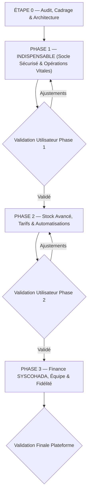

# PLAN DE REFONTE & D'EXTENSION ERP — YOS360

**Projet** : YOS360 — ERP SaaS Multi-Tenant & Multi-Sites UEMOA  
**Norme de livraison** : Phase par phase avec validation intermédiaire obligatoire  
**Date d'établissement** : 19 Octobre 2026  
**Document de référence** : [docs/AUDIT.md](file:///c:/Users/OUANGRAWA/Desktop/P%20Digital/YOS360/docs/AUDIT.md)

---

## 1. Vue d'Ensemble des Phases de Développement

---

## 2. Découpage Détaillé par Phase

---

### ÉTAPE 0 — AUDIT & ARCHITECTURE PRÉALABLE (EN COURS)
- [x] **0.1 Analyse approfondie du dépôt** : stack, arborescence, schémas de BDD, RLS, offline, UI.
- [x] **0.2 Production de `docs/AUDIT.md`** : recensement existant, réutilisabilité, failles RLS, dettes techniques et écarts.
- [x] **0.3 Production de `docs/PLAN.md`** : phasage détaillé, migrations up/down, identification des risques.
- [x] **0.4 Restructuration de base de l'architecture des espaces** :
  - **Espace Super Admin Plateforme** (séparé) avec fonction d'impersonation tracée.
  - **Espace Entreprise (Tenant)** avec le nouveau menu 9 sections ordonné.
  - Sélecteur de site global dans l'en-tête (`site_id`).
  - Nettoyage des badges statiques (SCAN, AUTO, VENTE, etc.) au profit de compteurs dynamiques réels.

---

### PHASE 1 — INDISPENSABLE (LIVRÉE)

#### 1.1 Rôles & Permissions (RBAC Granulaire BDD)
- [x] **Migration SQL** :
  - Tables créées : `roles`, `permissions`, `role_permissions`, `user_roles`, `user_sites`, `user_sessions`.
  - 6 rôles fondamentaux configurés (`Propriétaire`, `Gérant`, `Comptable`, `Magasinier`, `Caissier`, `Vendeur`).
  - Permissions granulaires format `module.action`.
  - Correction de la faille multi-tenant RLS via `public.is_super_admin()`.
- [x] **API & Logique Métier** :
  - Helpers de vérification dynamique `hasPermission(role, permissionCode, userSites, targetSiteId)`.
- [x] **Interface Utilisateur** :
  - Matrice visuelle de permissions (Modules × Actions) dans `Paramètres > Utilisateurs & Rôles`.
  - Écran d'assignation des sites/boutiques par utilisateur.
  - Prise en charge 2FA (TOTP) et liste des sessions actives avec révocation instantanée.

#### 1.2 Module Achats Complet
- [x] **Migration SQL** :
  - Tables créées : `achats_demandes`, `achats_demande_lignes`, `achats_bons_commande`, `achats_bc_lignes`, `achats_receptions`, `achats_reception_lignes`, `achats_factures`, `achats_retours`.
  - Intégration `site_id`, `created_by`, `deleted_at`.
- [x] **Logique Métier & Interface** :
  - Chaîne complète : Demandes d'Achat (DA) avec conversion 1-clic → Bons de Commande (BC) → Réception avec recalcul automatique du CMUP.
  - Écran de Rapprochement 3-Voies (BC / Réception / Facture) avec détection des écarts de quantité et de prix.
  - Module de retours fournisseurs avec déduction de stock et traçabilité pour avoirs.

#### 1.3 Ventes & Facturation Structurée
- [x] **Migration SQL & Inviolabilité** :
  - Tables : `ventes_devis`, `ventes_commandes`, `ventes_livraisons`, `ventes_factures`, `ventes_avoirs`.
  - Trigger PostgreSQL `check_facture_inviolability` bloquant toute altération d'une facture validée.
- [x] **Génération de Documents PDF Conforme UEMOA** :
  - Modèle commercial officiel avec Numéro IFU, RCCM, Division fiscale, TVA 18%.

#### 1.4 Caisse Enregistreuse (POS) Professionnelle
- [x] **Sessions de Caisse & Ticket Z** :
  - Ouverture avec fond de caisse initial obligatoire.
  - Clôture avec comptage physique détaillé (espèces & Mobile Money), calcul immédiat de l'écart.
  - Génération et impression du Ticket Z journalier officiel.
- [x] **Paiements Fractionnés / Multiples** :
  - Possibilité de régler un panier par combinaison de moyens (Espèces, Orange Money, Moov, Wave, Crédit).
- [x] **Plafond de Crédit Bloquant** :
  - Blocage automatique en caisse si le client dépasse son `encours_max`.
- [x] **Mode Hors-Ligne Robuste** :
  - Enfilement IndexedDB (`offline.ts`) sans coupure de caisse lors des pannes internet, synchronisation automatique.

#### 1.5 Paiements, Mobile Money & Gestion des Créances
- [x] **Table unifiée `payments`** :
  - Rattachée aux encaissements clients et décaissements fournisseurs.
  - Adaptateurs télécom : Orange Money, Moov Money, Wave, Banques, Espèces.
- [x] **Balance Âgée Interactive** :
  - 4 tranches d'ancienneté : 0-30 jours, 31-60 jours, 61-90 jours, +90 jours.
  - Boutons de relance WhatsApp en un clic avec message pré-rempli.

---

### PHASE 2 — STOCK AVANCÉ, TARIFS & AUTOMATISATION (LIVRÉE)

- [x] **2.1 Traçabilité fine & FEFO** :
  - Lots, numéros de série, dates de péremption (DLUO), statut quarantaine/rejeté/actif.
  - Algorithme de déstockage automatique FEFO (`calculerSortieFEFO`, RPC `rpc_fefo_proposer_lots`).
  - Alertes visuelles et notifications automatiques à J-30 et J-7 (`getDluoStatut`).
  - Écran complet AdminLTE `Lots & Péremptions` avec simulateur interactif FEFO.
- [x] **2.2 Valorisation du Stock** :
  - Méthodes configurables par tenant : CMUP (Coût Moyen Unitaire Pondéré) ou FIFO.
  - RPC SQL `rpc_calcul_valorisation_stock` + InfoBox de valorisation dans le catalogue.
- [x] **2.3 Nomenclatures, Variantes & Unités** :
  - Unités de mesure avec table de conversion (ex. 1 Carton = 10 Paquets = 100 Pièces, table `produit_unites`).
  - Variantes matricielles de produits (taille, couleur, conditionnement, table `produit_variantes`).
  - Kits et produits composés avec décrémentation automatique des composants (table `produit_composants`).
  - Modals dédiés AdminLTE intégrés dans le catalogue Produits.
- [x] **2.4 Ajustements de Stock Réglementés** :
  - Formulaire d'ajustement avec motif obligatoire (`casse`, `vol`, `echantillon`, `peremption`, `ecart_inventaire`, `revalorisation`).
  - Seuil de valeur paramétrable (défaut 50 000 FCFA) déclenchant une redirection vers le workflow de validation.
  - Tables `stock_ajustements` et `stock_ajustement_lignes` + RPC `rpc_approuver_ajustement_stock`.
- [x] **2.5 Grilles Tarifaires & Promotions** :
  - Listes de prix par catégorie de clients (`detail`, `demi_gros`, `grossiste`, `vip`, tables `grilles_tarifaires` & `grille_tarifaire_lignes`).
  - Remises quantitatives par palier de volume, promotions datées, coupons et codes promo (table `promotions`).
  - Écran complet AdminLTE `Grilles & Promotions` avec simulateur de calcul en temps réel.
- [x] **2.6 Workflows de Validation & Notifications** :
  - Écran « Validations en attente » pour ajustements de stock, remises exceptionnelles, transferts inter-sites.
  - Table universelle `validations_workflow` avec approbation/rejet motivé et traçabilité de décision.
  - Table `notifications_queue` multi-canaux (in-app, email, SMS, WhatsApp).
- [x] **2.7 Webhooks Sortants & Observabilité** :
  - Émission d'événements signés par HMAC-SHA256 (`vente.creee`, `stock.alerte`, `facture.payee`, `ajustement.valide`).
  - Table `webhook_deliveries` pour la traçabilité et simulateur de test de livraison avec signature `X-YOS360-Signature`.

---

### PHASE 3 — FINANCE SYSCOHADA, ÉQUIPE & FIDÉLITÉ

- **3.1 Pré-Comptabilité SYSCOHADA Révisé** :
  - Plan comptable général OHADA pré-configuré (Comptes classes 1 à 7).
  - Journaux auxiliaires : Ventes, Achats, Banque, Caisse, Opérations Diverses.
  - Génération automatique des écritures comptables à partir des factures et encaissements/décaissements.
  - Grand livre, balance générale et export FEC / Excel.
- **3.2 Trésorerie & Dépenses** :
  - Gestion des comptes bancaires et des comptes marchands Mobile Money.
  - Rapprochement bancaire assisté.
  - Gestion des charges et dépenses d'exploitation par catégorie budgétaire.
- **3.3 Gestion de l'Équipe & Commissions** :
  - Fiche collaborateur, rattachement aux sites d'affectation.
  - Règles de calcul des commissions vendeurs (% sur CA ou marge).
  - Suivi des objectifs mensuels par vendeur et par boutique.
- **3.4 Programme de Fidélité & Vue Client 360°** :
  - Cumul de points de fidélité, paliers de fidélité (Bronze, Argent, Or).
  - Vue Client 360° : historique d'achats, panier moyen, solde dû, retours, préférences.

---

## 3. Plan des Migrations SQL (Phase 1)

| Ordre | Fichier de Migration | Description & Contenu |
| :---: | :--- | :--- |
| **01** | `20261020000001_core_multi_tenant_security.sql` | Correction étanche du RLS, isolation stricte `entreprise_id`/`tenant_id`, contexte d'impersonation sécurisé pour le super-admin. |
| **02** | `20261020000002_rbac_dynamic_roles_permissions.sql` | Création des tables `roles`, `permissions`, `role_permissions`, `user_roles`, `user_sites`, seed des 6 rôles et des permissions `module.action`. |
| **03** | `20261020000003_purchases_module_schema.sql` | Création de la chaîne Achats : `achats_demandes`, `achats_bons_commande`, `achats_receptions`, `achats_factures`, `achats_retours` + triggers CMUP. |
| **04** | `20261020000004_sales_invoicing_module_schema.sql` | Création de la chaîne Ventes : `ventes_devis`, `ventes_commandes`, `ventes_livraisons`, `ventes_factures`, `ventes_avoirs` + compteurs atomiques. |
| **05** | `20261020000005_pos_cash_register_sessions.sql` | Création de la gestion de caisse : `caisse_postes`, `caisse_sessions`, `caisse_mouvements_fond`, `caisse_paiements`, calcul ticket Z. |
| **06** | `20261020000006_payments_mobile_money_aging.sql` | Table unifiée `payments`, adaptateurs Mobile Money, calcul balance âgée et plafonds de crédit. |
| **07** | `20261020000007_audit_logs_soft_delete.sql` | Table `audit_logs` universelle enrichie (IP, tenant, site, diff JSONB) + ajout `deleted_at` sur toutes les entités métier. |

---

## 4. Matrice des Risques & Stratégies d'Atténuation

| Risque Identifié | Impact | Probabilité | Plan d'Atténuation |
| :--- | :---: | :---: | :--- |
| **Régression sur les données existantes** (produits, clients, stocks existants) | Critique | Moyenne | Migration non destructive : aucune colonne existante n'est supprimée ; création de vues de compatibilité si nécessaire. |
| **Conflits de stock lors de la synchronisation hors-ligne** | Élevé | Élevée | Résolution transactionnelle stricte côté serveur dans `rpc_sync_pos_offline` avec verrouillage pessimiste (`SELECT FOR UPDATE`) et notification d'anomalie. |
| **Complexité perçue de la nouvelle arborescence** | Moyen | Moyenne | Navigation ergonomique AdminLTE v4, recherche globale `Ctrl+K`, filtres intelligents et raccourcis clavier pour la caisse. |
| **Perte de performance sur les calculs de balance âgée et de stock** | Moyen | Faible | Indexation systématique sur `(tenant_id, site_id, created_at, statut)`, pagination serveur native, requêtes agrégées optimisées. |
| **Erreurs de calcul de TVA ou d'arrondis en devise XOF** | Élevé | Faible | Règle d'or : type `numeric` sans décimale pour le FCFA, arrondi mathématique standardisé dans une fonction centralisée. |

---

## 5. Protocole de Validation & Critères d'Acceptation de la Phase 1

À la livraison de la Phase 1, les tests suivants seront démontrés en direct dans l'interface et dans la base de données :
1. **Épreuve d'étanchéité multi-tenant** : Un utilisateur du Tenant A ne peut en aucun cas lire ou modifier les données du Tenant B, même s'il possède le rôle Administrateur dans le Tenant A.
2. **Épreuve multi-sites** : Un caissier assigné au Site 1 ne peut pas enregistrer une vente sur le Site 2.
3. **Épreuve du cycle Achats** : Une demande d'achat se convertit en bon de commande, puis en réception partielle sur un dépôt spécifique, avec mise à jour immédiate et exacte du stock du dépôt et du CMUP produit.
4. **Épreuve du cycle Ventes** : Un devis se transforme en commande client, bon de livraison et facture numérotée sans trou de séquence.
5. **Épreuve de la Caisse POS** : Ouverture d'une session avec fond de caisse, vente combinée (Espèces + Mobile Money), clôture avec comptage physique et génération du ticket Z avec écart.
6. **Épreuve hors-ligne** : Coupure de la connexion réseau, saisie d'un encaissement en caisse, rétablissement du réseau et vérification de la synchronisation sans doublon.
7. **Épreuve d'inviolabilité comptable** : Tentative de modification d'une facture validée bloquée par le système (annulation uniquement possible via avoir).
